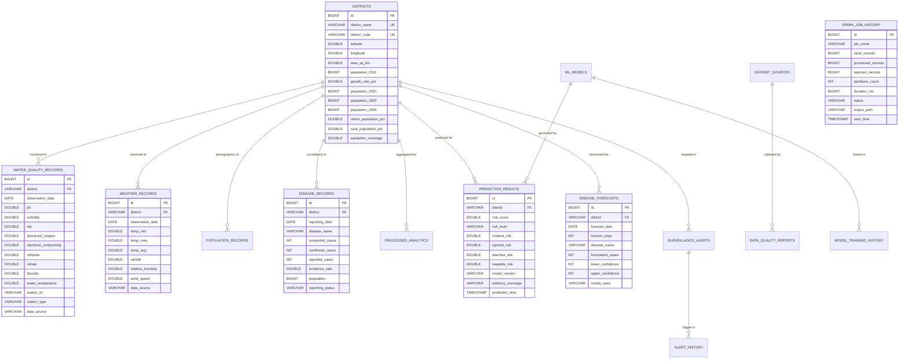

# AquaSafe: Relational Database Schema & Data Architecture

This document specifies the relational database schema, tables, keys, indexing strategies, and entity relationships powering the **AquaSafe** platform.

The system is configured with a **Dual-Mode Database Architecture**:
- **Production Engine:** MySQL 8.x on port 3306.
- **Embedded Fallback Engine:** H2 Database running in `MODE=MySQL` with complete DDL/DML compatibility when MySQL is inactive.

---

## 1. Entity-Relationship (ER) Diagram

---

## 2. Table Specifications & Schema Definitions

### 1. `districts`
Central master registry for all 38 districts of Tamil Nadu.
- **`id`**: `BIGINT AUTO_INCREMENT PRIMARY KEY`
- **`district_name`**: `VARCHAR(100) NOT NULL UNIQUE` (Indexed)
- **`district_code`**: `VARCHAR(10) NOT NULL UNIQUE` (e.g. `TN-01`)
- **`latitude`**: `DOUBLE NOT NULL`
- **`longitude`**: `DOUBLE NOT NULL`
- **`area_sq_km`**: `DOUBLE`
- **`population_2011`**: `BIGINT NOT NULL`
- **`growth_rate_pct`**: `DOUBLE NOT NULL`
- **`population_2021`**: `BIGINT NOT NULL`
- **`population_2025`**: `BIGINT NOT NULL`
- **`population_2026`**: `BIGINT NOT NULL`
- **`urban_population_pct`**: `DOUBLE`
- **`rural_population_pct`**: `DOUBLE`
- **`sanitation_coverage`**: `DOUBLE`

### 2. `dataset_sources`
Tracks data provenance, verification state, and government URLs.
- **`id`**: `BIGINT AUTO_INCREMENT PRIMARY KEY`
- **`source_name`**: `VARCHAR(150) NOT NULL`
- **`source_url`**: `VARCHAR(500) NOT NULL`
- **`category`**: `VARCHAR(50) NOT NULL` (`WATER_QUALITY`, `WEATHER`, `DEMOGRAPHICS`, `DISEASE`)
- **`observation_period`**: `VARCHAR(100)`
- **`district_coverage`**: `VARCHAR(100)`
- **`record_count`**: `BIGINT`
- **`data_format`**: `VARCHAR(50)`
- **`validation_status`**: `VARCHAR(50)`
- **`classification`**: `VARCHAR(50)` (`ACTUAL_HISTORICAL`, `ESTIMATED`, `SYNTHETIC`)

### 3. `water_quality_records`
Stores historical laboratory tests and sensor observations.
- **`id`**: `BIGINT AUTO_INCREMENT PRIMARY KEY`
- **`district`**: `VARCHAR(100) NOT NULL` (Indexed, FK -> districts)
- **`observation_date`**: `DATE NOT NULL` (Indexed)
- **`ph`**: `DOUBLE NOT NULL`
- **`turbidity`**: `DOUBLE NOT NULL`
- **`tds`**: `DOUBLE NOT NULL`
- **`dissolved_oxygen`**: `DOUBLE NOT NULL`
- **`electrical_conductivity`**: `DOUBLE`
- **`chloride`**: `DOUBLE`
- **`nitrate`**: `DOUBLE`
- **`fluoride`**: `DOUBLE`
- **`water_temperature`**: `DOUBLE`
- **`station_id`**: `VARCHAR(50)`
- **`station_type`**: `VARCHAR(50)` (`GROUNDWATER_LAB`, `DRINKING_WATER_SENSOR`)
- **`data_source`**: `VARCHAR(100)`
- **`missing_parameters`**: `VARCHAR(255)`

### 4. `weather_records`
Daily meteorological measurements.
- **`id`**: `BIGINT AUTO_INCREMENT PRIMARY KEY`
- **`district`**: `VARCHAR(100) NOT NULL` (Indexed)
- **`observation_date`**: `DATE NOT NULL` (Indexed)
- **`temp_min`**: `DOUBLE NOT NULL`
- **`temp_max`**: `DOUBLE NOT NULL`
- **`temp_avg`**: `DOUBLE NOT NULL`
- **`rainfall`**: `DOUBLE NOT NULL`
- **`relative_humidity`**: `DOUBLE NOT NULL`
- **`wind_speed`**: `DOUBLE`
- **`data_source`**: `VARCHAR(100)`

### 5. `population_records`
Historical decennial and CAGR projected population values.
- **`id`**: `BIGINT AUTO_INCREMENT PRIMARY KEY`
- **`district`**: `VARCHAR(100) NOT NULL` (Indexed)
- **`total_population`**: `BIGINT NOT NULL`
- **`population_density`**: `DOUBLE NOT NULL`
- **`urban_population`**: `BIGINT`
- **`rural_population`**: `BIGINT`
- **`sanitation_coverage`**: `DOUBLE NOT NULL`
- **`population_year`**: `INT NOT NULL` (Indexed)
- **`source`**: `VARCHAR(100)`

### 6. `disease_records`
Epidemiological case reports tracking 4 water-borne diseases.
- **`id`**: `BIGINT AUTO_INCREMENT PRIMARY KEY`
- **`district`**: `VARCHAR(100) NOT NULL` (Indexed)
- **`disease_name`**: `VARCHAR(100) NOT NULL` (Indexed)
- **`reported_cases`**: `INT NOT NULL`
- **`confirmed_cases`**: `INT`
- **`suspected_cases`**: `INT`
- **`incidence_rate`**: `DOUBLE NOT NULL`
- **`reporting_date`**: `DATE NOT NULL` (Indexed)
- **`reporting_period`**: `VARCHAR(20)`
- **`population`**: `BIGINT`
- **`data_source`**: `VARCHAR(100)`
- **`reporting_status`**: `VARCHAR(50)`

### 7. `data_quality_reports`
Automated dataset validation, missingness, and deduplication audit logs.
- **`id`**: `BIGINT AUTO_INCREMENT PRIMARY KEY`
- **`dataset_name`**: `VARCHAR(150) NOT NULL`
- **`records_evaluated`**: `BIGINT`
- **`missing_values_count`**: `BIGINT`
- **`duplicate_count`**: `BIGINT`
- **`outlier_count`**: `BIGINT`
- **`completeness_rate`**: `DOUBLE`
- **`status`**: `VARCHAR(50)`
- **`evaluation_time`**: `TIMESTAMP`

### 8. `processed_analytics`
Spark-aggregated district and monthly features.
- **`id`**: `BIGINT AUTO_INCREMENT PRIMARY KEY`
- **`district`**: `VARCHAR(100) NOT NULL` (Indexed)
- **`month`**: `INT NOT NULL`
- **`year`**: `INT NOT NULL` (Indexed)
- **`calculated_wqi`**: `DOUBLE NOT NULL`
- **`wqi_status`**: `VARCHAR(50)`
- **`total_cases`**: `BIGINT NOT NULL`
- **`incidence_rate`**: `DOUBLE NOT NULL`
- **`primary_risk_disease`**: `VARCHAR(100)`
- **`processed_date`**: `TIMESTAMP`

### 9. `ml_models`
Metadata repository for trained machine learning models.
- **`id`**: `BIGINT AUTO_INCREMENT PRIMARY KEY`
- **`model_name`**: `VARCHAR(100) NOT NULL`
- **`algorithm`**: `VARCHAR(100) NOT NULL`
- **`version`**: `VARCHAR(50) NOT NULL`
- **`accuracy`**: `DOUBLE`
- **`precision_val`**: `DOUBLE`
- **`recall_val`**: `DOUBLE`
- **`f1_score`**: `DOUBLE`
- **`roc_auc`**: `DOUBLE`
- **`model_path`**: `VARCHAR(255)`
- **`active`**: `BOOLEAN NOT NULL`

### 10. `model_training_history`
Audit history of model training executions, cross-validation metrics, and split dates.
- **`id`**: `BIGINT AUTO_INCREMENT PRIMARY KEY`
- **`model_id`**: `BIGINT` (FK -> ml_models)
- **`training_date`**: `TIMESTAMP`
- **`training_samples`**: `INT`
- **`testing_samples`**: `INT`
- **`accuracy`**: `DOUBLE`
- **`f1_score`**: `DOUBLE`
- **`split_strategy`**: `VARCHAR(100)`

### 11. `prediction_results`
Persistent store of all executed disease risk evaluations.
- **`id`**: `BIGINT AUTO_INCREMENT PRIMARY KEY`
- **`district`**: `VARCHAR(100) NOT NULL` (Indexed)
- **`ph`**: `DOUBLE`
- **`turbidity`**: `DOUBLE`
- **`tds`**: `DOUBLE`
- **`dissolved_oxygen`**: `DOUBLE`
- **`rainfall`**: `DOUBLE`
- **`temperature`**: `DOUBLE`
- **`humidity`**: `DOUBLE`
- **`population_density`**: `DOUBLE`
- **`sanitation_coverage`**: `DOUBLE`
- **`risk_score`**: `DOUBLE NOT NULL`
- **`risk_level`**: `VARCHAR(20) NOT NULL` (Indexed)
- **`cholera_risk`**: `DOUBLE`
- **`typhoid_risk`**: `DOUBLE`
- **`diarrhea_risk`**: `DOUBLE`
- **`hepatitis_risk`**: `DOUBLE`
- **`model_version`**: `VARCHAR(50)`
- **`advisory_message`**: `TEXT`
- **`prediction_time`**: `TIMESTAMP NOT NULL` (Indexed)

### 12. `disease_forecasts`
Time-series prospective predictions for 7-day and 30-day horizons.
- **`id`**: `BIGINT AUTO_INCREMENT PRIMARY KEY`
- **`district`**: `VARCHAR(100) NOT NULL` (Indexed)
- **`forecast_date`**: `DATE NOT NULL` (Indexed)
- **`horizon_days`**: `INT NOT NULL` (7 or 30)
- **`disease_name`**: `VARCHAR(100) NOT NULL`
- **`forecasted_cases`**: `INT NOT NULL`
- **`lower_confidence`**: `INT NOT NULL`
- **`upper_confidence`**: `INT NOT NULL`
- **`model_used`**: `VARCHAR(100)`
- **`mae`**: `DOUBLE`
- **`rmse`**: `DOUBLE`

### 13. `surveillance_alerts`
Active outbreak and water contamination alerts.
- **`id`**: `BIGINT AUTO_INCREMENT PRIMARY KEY`
- **`district`**: `VARCHAR(100) NOT NULL` (Indexed)
- **`severity`**: `VARCHAR(20) NOT NULL` (`CRITICAL`, `WARNING`, `INFO`)
- **`disease`**: `VARCHAR(100) NOT NULL`
- **`message`**: `TEXT NOT NULL`
- **`created_at`**: `TIMESTAMP NOT NULL`
- **`read_status`**: `BOOLEAN NOT NULL DEFAULT FALSE`

### 14. `alert_history`
Audit trail of notifications dispatched to field health officers.
- **`id`**: `BIGINT AUTO_INCREMENT PRIMARY KEY`
- **`alert_id`**: `BIGINT` (FK -> surveillance_alerts)
- **`recipient`**: `VARCHAR(150)`
- **`channel`**: `VARCHAR(50)` (`DASHBOARD`, `SMS`, `EMAIL`)
- **`sent_at`**: `TIMESTAMP`

### 15. `spark_job_history`
Persistent log of distributed Spark DataFrame transformations.
- **`id`**: `BIGINT AUTO_INCREMENT PRIMARY KEY`
- **`job_name`**: `VARCHAR(150) NOT NULL`
- **`input_records`**: `BIGINT NOT NULL`
- **`processed_records`**: `BIGINT NOT NULL`
- **`rejected_records`**: `BIGINT NOT NULL`
- **`partitions_count`**: `INT NOT NULL`
- **`duration_ms`**: `BIGINT NOT NULL`
- **`status`**: `VARCHAR(50) NOT NULL` (`SUCCESS`, `FAILED`)
- **`output_path`**: `VARCHAR(255)`
- **`triggered_by`**: `VARCHAR(100)`
- **`start_time`**: `TIMESTAMP NOT NULL`

### 16. `users`
Role-based user accounts and authentication.
- **`id`**: `BIGINT AUTO_INCREMENT PRIMARY KEY`
- **`username`**: `VARCHAR(50) NOT NULL UNIQUE` (Indexed)
- **`password`**: `VARCHAR(255) NOT NULL`
- **`full_name`**: `VARCHAR(100)`
- **`email`**: `VARCHAR(100)`
- **`role`**: `VARCHAR(50) NOT NULL` (`ADMIN`, `PUBLIC_HEALTH_ANALYST`, `DISTRICT_HEALTH_OFFICER`)
- **`department`**: `VARCHAR(100)`
- **`created_at`**: `TIMESTAMP`

### 17. `reports`
Generated epidemiological reports and executive summaries.
- **`id`**: `BIGINT AUTO_INCREMENT PRIMARY KEY`
- **`report_title`**: `VARCHAR(200) NOT NULL`
- **`district_filter`**: `VARCHAR(100)`
- **`start_date`**: `DATE`
- **`end_date`**: `DATE`
- **`high_risk_count`**: `INT`
- **`med_risk_count`**: `INT`
- **`low_risk_count`**: `INT`
- **`generated_at`**: `TIMESTAMP NOT NULL`

---

## 3. Indexing Strategy

To guarantee sub-10ms query execution across multi-year data:
1. **Composite Index on `(district, observation_date)`**: Applied to `water_quality_records`, `weather_records`, and `disease_records` for fast time-series joins.
2. **Clustered Index on `(district, horizon_days)`**: Applied to `disease_forecasts` for instant prospective dashboard filtering.
3. **Index on `(read_status, severity)`**: Applied to `surveillance_alerts` for real-time navbar notification polling.

