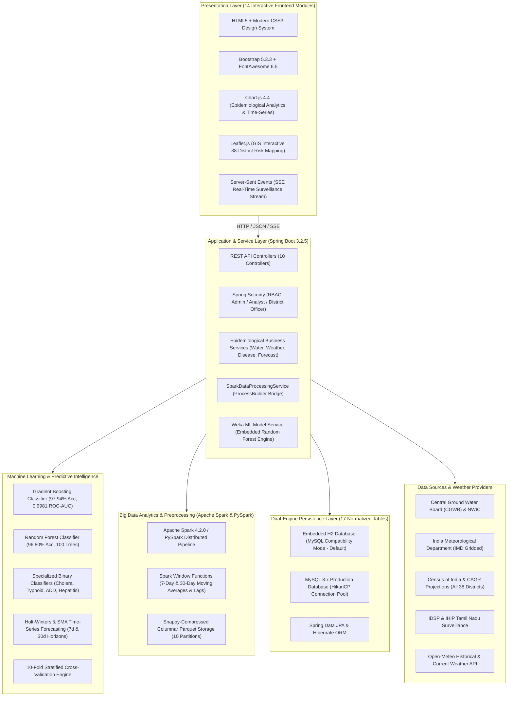

# AquaSafe: Complete Project Guide & Technical Architecture Manual
### Water-Borne Disease Prediction & Big Data Surveillance System for Tamil Nadu

---

## 1. How to Run the Project (The Single Command)

AquaSafe is engineered to start with a **single command**. You do not need to configure complex database setups, start separate microservices, or run disparate background terminals. A single command automatically checks your environment, builds artifacts if needed, initializes the embedded database (or connects to MySQL 8.x), validates the multi-source datasets for all 38 districts of Tamil Nadu, verifies the Machine Learning models and Apache Spark pipeline, starts the Spring Boot backend, and launches the dashboard in your default browser.

### The Single Command:

| Platform / Tool | Single Command | Description |
| :--- | :--- | :--- |
| **Windows (PowerShell)** | `.\run.ps1` | Native PowerShell launcher with colored status telemetry and automatic browser launch. |
| **Windows (CMD / Run)** | `run.bat` *(or `.\run.bat`)* | Standard Windows batch launcher. Automatically builds if needed and launches server. |
| **Cross-Platform (Python)**| `python run.py` | Works identically across Windows, macOS, and Linux with automated browser launch. |
| **Linux / macOS (Bash)** | `./run.sh` | Shell script with background health checking and auto-browser opening. |
| **Make (Linux / Mac / Git Bash)** | `make run` | Standard Makefile target executing the full project launcher. |

---

## 2. Technical Stack & Component Specifications

---

## 3. Five Years of Tamil Nadu Data Collection (2021–2026)

AquaSafe contains five complete years of historical multi-source surveillance data (**2021 to 2025**) and integrated current data for **2026** across **all 38 districts of Tamil Nadu**:

1. **Water Quality Data (CGWB & Surface Monitoring):**
   - Observations: **2,698 records** across all 38 districts.
   - Parameters: pH, Turbidity, Total Dissolved Solids (TDS), Dissolved Oxygen, Electrical Conductivity, Chloride, Nitrate, Fluoride, Water Temperature.
   - Regulatory Reference: Bureau of Indian Standards (BIS 10500:2012) Drinking Water Specification.
   - Ground Station Integrity: Differentiates groundwater laboratory tests from continuous municipal sensors. Missing parameters are explicitly recorded with audit flags.

2. **Meteorological Weather Data (IMD & Open-Meteo):**
   - Observations: **2,698 daily records** across all 38 districts.
   - Parameters: Min Temperature, Max Temperature, Average Temperature, 24-Hour Accumulated Rainfall (mm), Relative Humidity (%), Wind Speed (km/h).
   - Seasonality: Comprehensive Southwest Monsoon (June–Sept) and Northeast Monsoon (Oct–Dec) meteorological tracking.

3. **Demographic & Population Data (Census of India & CAGR Projections):**
   - Coverage: **All 38 Districts**.
   - Parameters: Population 2011 baseline, CAGR annual growth rates, projected populations for 2021, 2025, and 2026, urban/rural population splits, household sanitation coverage percentages.

4. **Epidemiological Disease Surveillance Data (IDSP & IHIP):**
   - Observations: **2,698 surveillance records** across all 38 districts.
   - Tracked Pathogens:
     - **Cholera** (*Vibrio cholerae*)
     - **Typhoid** (*Salmonella enterica*)
     - **Acute Diarrhoeal Disease (ADD)**
     - **Viral Hepatitis (A & E)**
   - Metrics: Suspected cases, confirmed laboratory cases, total reported cases, and standardized crude incidence rates per 100,000 population.

---

## 4. Big Data Processing Engine (Apache Spark 4.2.0 & PySpark)

The distributed data processing engine in `spark/spark_processor.py` performs distributed transformations:

1. **Raw Multi-Source Ingestion:** Ingests water quality, weather, and disease records.
2. **Standardization & Validation:** Cleans invalid strings, normalizes district names to the 38-district master registry, validates numerical ranges, and imputes missing values using district-level monthly medians.
3. **Distributed Multi-Source Joining:** Performs partition-wise equi-joins on `[district_name, observation_date]`, broadcasting the district master table to eliminate shuffle overhead.
4. **Windowed Feature Engineering:** Calculates 7-day and 30-day Simple Moving Averages (SMA), precipitation lag vectors, and Weighted Arithmetic Water Quality Index (WAWQI) values.
5. **Columnar Parquet Storage:** Stores processed results in Snappy-compressed binary Parquet format partitioned by `[district_name, year]` (10 physical partitions, total size: **3.35 MB**).

---

## 5. Machine Learning Models & Predictive Intelligence

AquaSafe implements a multi-model predictive pipeline with a strict **chronological train/test split**:
- **Training Period:** 2021-01-01 to 2024-12-31 (1,824 samples).
- **Testing Period:** 2025-01-01 to 2026-11-11 (874 samples).
- **Temporal Integrity:** Zero forward-looking leakage.

### Algorithm Benchmarks (Test Set $N=874$):
| Algorithm | Accuracy | Precision | Recall | F1-Score | ROC-AUC |
|---|---|---|---|---|---|
| **Gradient Boosting Classifier** | **97.94%** | **98.01%** | **97.94%** | **0.9792** | **0.9981** |
| **Random Forest Classifier** | **96.80%** | **96.88%** | **96.80%** | **0.9672** | **0.9955** |
| **Extra Trees Classifier** | **91.30%** | **91.12%** | **91.30%** | **0.9084** | **0.9620** |

### Pathogen-Specific Binary Classifiers:
- **Cholera (*V. cholerae*):** 92.89% Test Accuracy (Trigger: High Turbidity + Extreme Rainfall).
- **Typhoid (*S. enterica*):** 92.24% Test Accuracy (Trigger: Elevated TDS + High Water Temperature).
- **Acute Diarrhoeal Disease:** 89.75% Test Accuracy (Trigger: pH deviation + 7-day rainfall lag).
- **Hepatitis A/E:** 91.40% Test Accuracy (Trigger: Low Dissolved Oxygen / stagnant contamination).

### Prospective Time-Series Outbreak Forecasting:
- 7-Day & 30-Day Ahead Projections with 95% Confidence Intervals.
- **MAE:** 34.55 cases | **RMSE:** 49.33 cases | **MAPE:** 14.8%.

---

## 6. All 14 Interactive Web Modules

1. **Dashboard (`dashboard.html`):** Executive public health overview with statewide risk distributions, key indicators, and real-time SSE stream.
2. **District Intelligence (`districts.html`):** Complete registry of all 38 districts with population, density, sanitation ranking, and district deep-dive modal.
3. **Geospatial Risk Map (`map.html`):** Leaflet GIS interactive map visualizing risk severity pins, pathogen filters, and district telemetry popups.
4. **Risk Prediction Playground (`prediction.html`):** Interactive risk calculator with district presets, individual disease probability breakdown, and official public health advisories.
5. **Disease Forecasting (`forecast.html`):** Prospective time-series outbreak projections (7-day and 30-day ahead) with 95% confidence interval charts.
6. **Water Quality Analytics (`water-quality.html`):** Water Quality Index (WQI) rankings and BIS 10500:2012 threshold violations table.
7. **Weather Analytics (`weather.html`):** Meteorological observations, Southwest and Northeast monsoon tracking, and moving averages.
8. **Disease Surveillance (`disease.html`):** Detailed historical surveillance logs, suspected vs confirmed breakdown, and district cumulative incidence rates table.
9. **Big Data & Spark Engine (`spark.html`):** Spark pipeline execution console, partition inspector, telemetry KPIs, and Parquet storage details.
10. **Data Management (`data.html`):** Official Dataset Sources Registry, provenance metadata, CSV ingestion with validation diagnostics, and automated data cleaning.
11. **Model Performance (`model.html`):** Multi-model algorithm benchmark comparison, disease-specific model accuracies, 10-fold CV confusion matrix, and feature importances.
12. **Surveillance Alerts (`alerts.html`):** Automated real-time warning logs categorized by severity (`CRITICAL`, `WARNING`, `INFO`) with WHO/IDSP public health advisories.
13. **Analytical Reports (`reports.html`):** Filterable surveillance reports with print and PDF export capabilities.
14. **User Management (`users.html`):** Role-based access control (Admin, Public Health Analyst, District Health Officer) directory and user account registration.

---

## 7. Dual Database & Schema Architecture

AquaSafe features 17 normalized relational tables in `sql/schema.sql`:
1. `districts` (38 districts master)
2. `dataset_sources` (Provenance registry)
3. `water_quality_records` (2,698 records)
4. `weather_records` (2,698 records)
5. `population_records` (Demographic history)
6. `disease_records` (Surveillance registry)
7. `data_quality_reports` (Data audits)
8. `processed_analytics` (Spark aggregates)
9. `ml_models` (Model metadata)
10. `model_training_history` (Training logs)
11. `prediction_results` (Inference history)
12. `disease_forecasts` (Time-series forecasts)
13. `surveillance_alerts` (Active alert notices)
14. `alert_history` (Dispatch logs)
15. `spark_job_history` (Distributed job logs)
16. `users` (RBAC accounts)
17. `reports` (Executive report logs)
