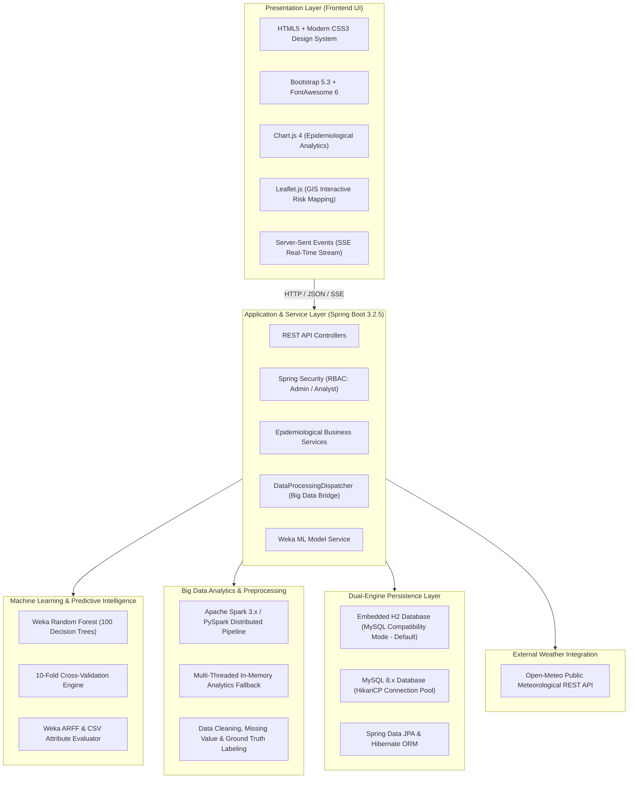

# AquaSafe: Complete Project Guide & Technical Documentation
### Water-Borne Disease Prediction & Big Data Surveillance System

---

## 1. How to Run the Project (The Single Command)

AquaSafe is engineered to start with a **single command**. You do not need to configure complex databases, start separate frontends, or run multiple background servers. A single command automatically checks your environment, builds artifacts if needed, initializes the embedded database, seeds demonstration data, trains the Weka Machine Learning model, starts the application server, and automatically launches the dashboard in your default browser.

### The Single Command:

Choose the command matching your preferred shell or operating system:

| Platform / Tool | Single Command | Description |
| :--- | :--- | :--- |
| **Windows (CMD / Run)** | `.\run.bat` *(or simply type `run`)* | **Recommended for Windows.** Double-click or run from CMD. Starts server and automatically opens browser. |
| **Windows (PowerShell)** | `.\run.ps1` | Native PowerShell launcher with ANSI status reporting and automatic browser launch. |
| **Cross-Platform (Python)**| `python run.py` | Works identically on Windows, macOS, and Linux. Automatically opens `http://localhost:8080`. |
| **Make (Linux / Mac / Git Bash)** | `make run` *(or `make`)* | Standard Makefile target executing the full project launcher. |
| **Linux / macOS (Bash)** | `./run.sh` | Bash script with automated background health-checking and browser opening. |

---

### What Happens Behind the Scenes in That Single Command:

When you execute the single command, AquaSafe executes the following automated startup sequence:

```
[1. Environmental Check]
    ├── Verifies Java 17+ is installed and present in PATH
    └── Verifies project paths (data/, ml/models/, frontend/)

[2. Package Verification & Build]
    ├── Checks if 'backend/target/aquasafe-backend-1.0.0-SNAPSHOT.jar' exists
    └── If missing, automatically triggers 'mvn clean package -DskipTests'

[3. Dual-Engine Database Auto-Configuration]
    ├── Probes MySQL on localhost:3306
    └── If MySQL is offline, automatically activates high-performance in-memory H2
        in MySQL compatibility mode (100% zero-configuration startup!)

[4. Data Seeding & Model Loading]
    ├── Imports demographic data for 10 Tamil Nadu districts (data/population_data.csv)
    ├── Imports 720 time-series water quality records (data/water_quality.csv)
    ├── Imports meteorological monitoring time-series (data/weather_data.csv)
    ├── Imports historical epidemiological disease case records (data/disease_records.csv)
    ├── Loads and validates the serialized Weka Random Forest model (100 decision trees)
    └── Creates default administrative & public health analyst credentials

[5. Server Startup & Automated Browser Launch]
    ├── Starts Spring Boot embedded Tomcat web server on http://localhost:8080
    ├── Background monitor polls http://localhost:8080/api/system/health
    └── Upon health confirmation (UP), automatically launches your default web browser!
```

---

## 2. Technical Stack

AquaSafe is built using an enterprise-grade, high-throughput modern technology stack designed for predictive healthcare analytics and big data processing:



### Detailed Component Specifications:

| Tier | Technology | Version | Purpose in AquaSafe |
| :--- | :--- | :--- | :--- |
| **Backend Framework** | **Spring Boot** | `3.2.5` | Application container, RESTful Web APIs, dependency injection, and security. |
| **Runtime Environment** | **Java OpenJDK** | `17 LTS` | Core programming language and virtual machine execution environment. |
| **Machine Learning** | **Weka Stable** | `3.8.6` | Random Forest classification algorithm, 10-fold cross-validation, and serialized model inference. |
| **Big Data Analytics** | **Apache Spark & PySpark** | `3.x` | Distributed dataset filtering, district-level rolling aggregations, and high-volume epidemiological join operations. |
| **Database (Zero-Config)**| **H2 Database** | `2.2.x` | In-memory database with MySQL compatibility mode for instantaneous, zero-install execution. |
| **Database (Production)** | **MySQL Server** | `8.x` | Enterprise relational storage managed via HikariCP high-performance connection pool. |
| **Data Ingestion** | **OpenCSV** | `5.9` | High-throughput streaming parser for multi-source CSV dataset importation. |
| **Security & Auth** | **Spring Security** | `6.2.x` | BCrypt password hashing, session tokens, and role-based access control (ADMIN, USER). |
| **Data Visualizations** | **Chart.js** | `4.4.x` | Dynamic line charts, risk distribution doughnuts, and rainfall correlation scatter plots. |
| **Geospatial Mapping** | **Leaflet.js** | `1.9.x` | Interactive OpenStreetMap GIS mapping with district-level risk radius markers and popups. |
| **Styling & Design System**| **Custom CSS3 + Bootstrap**| `5.3.3` | Tailored health intelligence UI theme featuring glassmorphism, micro-animations, and responsive layouts. |
| **Weather API** | **Open-Meteo REST API** | Free tier | Real-time live temperature, precipitation, and humidity feeds without API key friction. |

---

## 3. How It Works (End-to-End System Architecture)

AquaSafe operates as a closed-loop epidemiological surveillance and predictive intelligence system:

```
[1. Multi-Source Raw Data]
    ├── Water Quality Sensors (pH, Turbidity, TDS, Dissolved Oxygen, Water Temp)
    ├── Meteorological Feeds (Ambient Temp, Rainfall, Humidity from Open-Meteo)
    ├── Population Demographics (District Density, Sanitation Coverage Percentage)
    └── Hospital Records (Cholera, Typhoid, Diarrhea, Hepatitis Incidence)
                         │
                         ▼
[2. Automated Preprocessing & Ground Truth Engine]
    ├── Duplicate record detection & deduplication
    ├── Missing sensor value imputation
    ├── Outlier filtering based on valid WHO water safety bounds
    └── Deterministic risk label synthesis (HIGH / MEDIUM / LOW)
                         │
                         ▼
[3. Big Data Processing Engine (Dispatcher)]
    ├── Spark Cluster available? ──► YES ──► Distributed PySpark / Spark Job
    └── Cluster offline?         ──► NO  ──► Local Multi-threaded Stream Aggregator
                         │
                         ▼
[4. Weka Random Forest Machine Learning Engine]
    ├── Evaluates 10 environmental and demographic features
    ├── Computes probability distribution across risk classes
    └── Generates predicted risk label (HIGH, MEDIUM, or LOW) with confidence percentage
                         │
                         ▼
[5. Real-Time Surveillance & Alert Protocol]
    ├── Does risk evaluate to HIGH or exceed public safety contamination thresholds?
    ├── YES: Creates automated public health alert with actionable advisory notice
    └── NO:  Logs nominal status snapshot to persistent surveillance history
                         │
                         ▼
[6. Interactive Presentation & Intelligence Delivery]
    ├── Operational KPIs & Live SSE Real-time Feed
    ├── Geospatial Leaflet GIS Map with Risk-Heat Visualization
    ├── Dynamic Risk Prediction Playground with District Presets
    ├── Model Performance Dashboard with 10-Fold CV Confusion Matrix
    └── Analytical Public Health Reports with Print & PDF Export
```

### Detailed Functional Workflows:

#### A. Automated Data Preprocessing Pipeline
1. When multi-source CSV files are ingested (either during initial startup or via the **Data Management** screen), the system validates file integrity and column headers.
2. The `DataPreprocessingService` executes cleaning algorithms:
   - Detects and drops identical duplicate rows.
   - Filters physically impossible sensor values (e.g., pH outside 0–14, negative turbidity or rainfall).
   - Fills missing values with district-specific median baseline values.
   - Generates the deterministic public health ground-truth label based on composite risk factor scoring and clinical disease incidence.
3. Produces a standardized, clean dataset written to `ml/training/training_dataset.arff` ready for Machine Learning ingestion.

#### B. Machine Learning Risk Prediction Engine
1. AquaSafe utilizes an ensemble **Weka Random Forest** model configured with 100 decision trees.
2. The model accepts 10 predictive attributes:
   - `district` (Nominal categorical factor)
   - `ph` (Acidity / Alkalinity)
   - `turbidity` (Cloudiness / Suspended particulate in NTU)
   - `tds` (Total Dissolved Solids in mg/L)
   - `dissolved_oxygen` (Dissolved Oxygen in mg/L)
   - `temperature` (Ambient temperature in °C)
   - `rainfall` (Precipitation in mm)
   - `humidity` (Relative atmospheric humidity %)
   - `previous_disease_cases` (Recent localized infection count)
   - `population_density` (Persons per km²)
   - `sanitation_coverage` (Percentage of population with access to improved sanitation)
3. The classifier evaluates the features across all 100 trees and outputs:
   - Predicted Risk Category: `HIGH`, `MEDIUM`, or `LOW`.
   - Continuous estimated probability (0.0% to 100.0%).
   - Exact class probability distribution vector (`P(LOW)`, `P(MEDIUM)`, `P(HIGH)`).
   - Explanatory advisory text and public health disclaimers.

#### C. Big Data Processing Dispatcher
1. To accommodate environments with or without a live Apache Spark / Hadoop cluster, AquaSafe includes a `DataProcessingDispatcher`.
2. When a big data aggregation request is triggered:
   - It probes the Spark cluster master (`SPARK_MASTER`).
   - If connected, it runs distributed Spark transformations computing district averages, monthly disease totals, and environmental correlations.
   - If disconnected or running standalone, it automatically switches to `LocalDataProcessingService`, performing multi-threaded Java 17 stream processing over memory structures with zero downtime.

#### D. Geospatial Risk Intelligence
1. The **Risk Map** module interfaces with Leaflet.js to pinpoint all 10 monitored Tamil Nadu districts.
2. Dynamic color-coded circle markers reflect the latest machine-learning risk predictions:
   - **Red (`#ef4444`)**: High Risk Condition.
   - **Amber (`#f59e0b`)**: Moderate Risk Condition.
   - **Green (`#10b981`)**: Nominal Low Risk Condition.
3. Clicking any marker reveals district epidemiological KPIs, latest water quality parameters, and predictive confidence percentages.

---

## 4. Full Step-by-Step Operation Guide

### Step 1: System Requirements & Prerequisites
Before starting, ensure your system has:
- **Operating System**: Windows 10/11, macOS, or Linux.
- **Java**: Java JDK or JRE 17 or higher (`java -version`).
- **Memory**: Minimum 2 GB RAM (4 GB recommended).
- **Web Browser**: Any modern browser (Google Chrome, Microsoft Edge, Firefox, Brave, Safari).
- *(Optional)* Python 3.8+ if you wish to run the PySpark script or regenerate synthetic datasets.
- *(Optional)* MySQL 8.x if you wish to use MySQL instead of the built-in zero-config H2 database.

---

### Step 2: Launch the Project (The Single Command)

Open your terminal or command prompt in the AquaSafe project directory (`C:\Users\Admin\Documents\AquaSafe`), and run:

```cmd
.\run.bat
```
*(Or in PowerShell: `.\run.ps1` | Or in Python: `python run.py`)*

The system will start up and your web browser will automatically open to:
```
http://localhost:8080
```

---

### Step 3: Authentication & Login
AquaSafe includes built-in role-based security. Navigate to the Login screen (`login.html`) or use the default open session:

| Role | Username | Password | Access Capabilities |
| :--- | :--- | :--- | :--- |
| **System Administrator** | `admin` | `admin123` | Full administrative control: Upload CSV datasets, trigger automated data cleaning, retrain the Random Forest ML model, execute Big Data pipelines, and manage system alerts. |
| **Public Health Analyst** | `analyst` | `user123` | Operational public health user: View intelligence dashboards, perform real-time risk predictions, inspect Leaflet GIS maps, and export analytical surveillance reports. |

*(Quick Credential buttons are embedded directly on `login.html` for 1-click credential filling during demonstrations!)*

---

### Step 4: Step-by-Step Feature Walkthrough

#### 1. Intelligence Dashboard (`dashboard.html`)
- **Key Metrics Row**: Instant overview of Total Records Ingested, Districts Monitored (10), High Risk Districts, Medium Risk, Low Risk, and Active Critical Alerts.
- **Data Freshness Indicator**: Live badge showing `STORED DATA` or real-time streaming status with pulsating beacon.
- **Epidemiological Trend Charts**:
  - *Monthly Disease Incidence*: Interactive multi-line chart tracking Cholera, Typhoid, Diarrhea, and Hepatitis.
  - *Risk Classification Doughnut*: Proportional split between High, Medium, and Low risk districts.
  - *District Risk Comparison*: Bar chart comparing estimated disease risk likelihood across districts.
  - *Rainfall vs Disease Burden*: Scatter correlation plot illustrating disease spikes during monsoon precipitation.
- **Recent Surveillance Alerts**: Live feed of the latest epidemiological advisory warnings.

#### 2. Interactive Risk Map (`map.html`)
- **GIS Canvas**: Centered over Tamil Nadu, India (Chennai, Salem, Madurai, Coimbatore, Tiruchirappalli, Tirunelveli, Thanjavur, Vellore, Erode, Kanyakumari).
- **Interactive District Markers**: Click any district pin to inspect localized risk levels, probability scores, population density, and sanitation coverage.
- **Quick-Jump District Cards**: Click any district card in the right-hand panel to smoothly pan and zoom directly to that region.

#### 3. Machine Learning Risk Prediction (`prediction.html`)
- **Interactive Prediction Form**: Allows healthcare officials to input real-time sensor metrics:
  - *Water Parameters*: pH, Turbidity, TDS, Dissolved Oxygen.
  - *Weather Parameters*: Ambient Temperature, Rainfall (mm), Humidity (%).
  - *Epidemiological Factors*: Prior Disease Cases, Population Density, Sanitation Coverage (%).
- **Quick Preset Buttons**: Click **Chennai (Flood Scenario)**, **Salem (High Risk)**, **Coimbatore (Nominal)**, or **Kanyakumari (Safe)** to instantly populate the form with realistic test data.
- **Instant Weka Inference**: Click **"Run Disease Risk Assessment"** to submit the features to the Random Forest model.
- **Result Panel**:
  - Displays the estimated risk classification badge (`HIGH`, `MEDIUM`, or `LOW`).
  - Displays continuous probability percentage and a three-class probability breakdown bar.
  - Appends the result to the **Historical Prediction Audit Log** at the bottom of the page.

#### 4. Data Management & Preprocessing (`data.html`)
- **Automated Data Preprocessing Engine**:
  - Click **"Run Data Preprocessing"** to trigger the automated cleaning pipeline.
  - The system filters invalid readings, eliminates duplicates, synthesizes risk labels, and outputs cleaning statistics: *Records Before, Records After Cleaning, Duplicates Removed, and Missing Handled*.
- **Multi-Source CSV Dataset Ingestion**:
  - Upload new CSV surveillance files for *Water Quality, Weather Data, Disease Records, or Population Data*.
  - Instantly previews the first 5 records of uploaded datasets and logs file ingestion history.
- **Big Data Processing Trigger**:
  - Click **"Trigger Big Data Job"** in the top navigation bar to execute aggregated multi-district joins across data sources.

#### 5. Model Performance & Evaluation (`model.html`)
- **Authentic Weka Evaluation Metrics**:
  - *Accuracy*: Real 10-fold cross-validation accuracy score.
  - *Precision, Recall & F1-Score*: Class-weighted statistical measures.
- **Confusion Matrix**: Full 3x3 matrix showing True vs Predicted distribution across `LOW`, `MEDIUM`, and `HIGH` classes.
- **Class-Level Metrics**: Individual Precision, Recall, and F1-Scores for each disease risk severity.
- **Retrain Model**: Click **"Retrain Random Forest"** to re-execute 100-tree ensemble training directly from the latest training ARFF dataset.

#### 6. Surveillance Alerts & Warning Logs (`alerts.html`)
- **Trigger Protocol**: Automatically triggered whenever a district's predicted risk evaluates to `HIGH` (Probability $\ge$ 70%) or water contamination metrics exceed safety standards.
- **Alert Management**:
  - View district name, risk level, estimated probability, advisory notification, and timestamp.
  - Click **"Mark Read"** to acknowledge an alert, or **"Mark All as Read"** to clear all pending warning badges.

#### 7. Surveillance Analytics Reports (`reports.html`)
- **Dynamic Filtering**: Filter analytical records by **Target District** and **Date Range**.
- **Executive Summary KPIs**: Average pH, Average Turbidity, Total Recorded Disease Cases, and Average Estimated Risk.
- **Print & PDF Export**: Click **"Print / Export PDF"** in the top navigation to produce a styled, printer-friendly public health briefing document.

---

## 5. Complete REST API Reference

The Spring Boot backend exposes a complete set of RESTful endpoints:

| Category | HTTP Method | Endpoint Path | Description |
| :--- | :--- | :--- | :--- |
| **System** | `GET` | `/api/system/health` | Probes system status, database type, and ML model loaded flag. |
| **System** | `POST`| `/api/system/spark/process` | Triggers distributed Spark / local multi-threaded data processing. |
| **Auth** | `POST`| `/api/auth/login` | Authenticates user credentials and issues session token and role. |
| **Dashboard** | `GET` | `/api/dashboard/summary` | Retrieves aggregate metrics, district counts, and freshness status. |
| **Dashboard** | `GET` | `/api/dashboard/disease-trends` | Returns time-series case counts for all 4 tracked diseases. |
| **Dashboard** | `GET` | `/api/dashboard/risk-distribution` | Returns counts for LOW, MEDIUM, and HIGH risk districts. |
| **Dashboard** | `GET` | `/api/dashboard/district-risk` | Returns estimated risk likelihood scores for each district. |
| **Dashboard** | `GET` | `/api/dashboard/live-stream` | SSE endpoint streaming real-time dashboard metric updates. |
| **Prediction** | `POST`| `/api/predictions/predict` | Submits 10 environmental features to Weka Random Forest for risk evaluation. |
| **Prediction** | `GET` | `/api/predictions/history` | Fetches historical prediction audit records. |
| **Model** | `GET` | `/api/model/evaluation` | Returns 10-fold cross-validation metrics, confusion matrix, and tree count. |
| **Model** | `POST`| `/api/model/train` | Triggers retraining of the Random Forest classifier. |
| **Data Ingestion**| `POST`| `/api/datasets/upload` | Multipart endpoint accepting CSV uploads (`water_quality`, `weather_data`, etc.). |
| **Data Ingestion**| `GET` | `/api/datasets` | Retrieves audit log of all imported CSV datasets. |
| **Preprocessing**| `POST`| `/api/preprocessing/run` | Executes data deduplication, missing value handling, and ground truth labeling. |
| **Surveillance**| `GET` | `/api/water-quality` | Paginated queries for water quality sensor logs. |
| **Surveillance**| `GET` | `/api/weather/current` | Fetches live meteorological conditions from Open-Meteo for a given district. |
| **Surveillance**| `GET` | `/api/diseases` | Paginated queries for historical disease incidence records. |
| **Surveillance**| `GET` | `/api/population` | Returns demographic statistics and GPS coordinates for all 10 districts. |
| **Alerts** | `GET` | `/api/alerts` | Fetches active surveillance advisory notifications. |
| **Alerts** | `PUT` | `/api/alerts/{id}/read` | Acknowledges and marks an alert as READ. |
| **Alerts** | `PUT` | `/api/alerts/read-all` | Marks all active alerts as READ. |
| **Reports** | `GET` | `/api/reports` | Returns filtered analytical report datasets based on district and date range. |

---

## 6. Troubleshooting & FAQ

### Q1: What if port 8080 is already in use by another application?
**Answer**: You can change the port either via command line or by editing `backend/src/main/resources/application.properties`:
```cmd
java -Dserver.port=8085 -jar backend/target/aquasafe-backend-1.0.0-SNAPSHOT.jar
```
Or set the environment variable `PORT=8085` before running the single command.

### Q2: Do I need to install or start MySQL?
**Answer**: **No.** AquaSafe features an automatic dual-engine DataSource. If MySQL is not detected on `localhost:3306`, it automatically activates an embedded in-memory H2 database running in MySQL-compatibility mode. Everything functions identically with zero installation needed.

### Q3: How do I switch to MySQL if I want persistent disk storage?
**Answer**: 
1. Install and start MySQL Server 8.x.
2. Create the database: `CREATE DATABASE aquasafe;`
3. In `backend/src/main/resources/application.properties`, verify your credentials (`DB_USER=root`, `DB_PASSWORD=root`).
4. Start AquaSafe with the single command. The system will automatically detect MySQL and use it instead of H2!

### Q4: How do I execute the Apache Spark / PySpark job directly?
**Answer**: Run:
```cmd
python run.py --spark
```
*(Requires `pyspark` installed in your Python environment: `pip install pyspark`). If PySpark is not installed, AquaSafe's built-in Java `DataProcessingDispatcher` automatically performs all big data aggregations locally.*

### Q5: Can I regenerate or customize the demonstration datasets?
**Answer**: Yes! Run:
```cmd
python run.py --seed
```
This executes `generate_demo_data.py`, generating fresh, synchronized time-series data across all 10 Tamil Nadu districts.

---

### Project Directory Structure Overview:

```
AquaSafe/
├── run.bat                          # Single-command Windows launcher (1-Click Run)
├── run.ps1                          # Single-command PowerShell launcher
├── run.py                           # Single-command cross-platform Python launcher
├── run.sh                           # Single-command Linux/macOS bash launcher
├── Makefile                         # Single-command Make runner (make run)
├── PROJECT_GUIDE.md                 # Complete Project & Technical Execution Guide (This file)
├── RUN_GUIDE.md                     # Quick Reference Single-Command Run Guide
├── README.md                        # Project Overview & Quick Start
├── generate_demo_data.py            # Synthetic dataset generator
│
├── backend/                         # Spring Boot 3 Full-Stack Application
│   ├── pom.xml                      # Maven build configuration & dependencies
│   ├── src/main/java/com/aquasafe/  # Java Enterprise Source Code
│   │   ├── config/                  # DataSource (H2/MySQL), DataInitializer, Security
│   │   ├── controller/              # 13 REST API Controllers
│   │   ├── dto/                     # Request and Response Data Transfer Objects
│   │   ├── entity/                  # JPA Database Entities
│   │   ├── ml/                      # Weka Random Forest ML Service
│   │   ├── repository/              # Spring Data JPA Repositories
│   │   ├── service/                 # Business, Preprocessing & Prediction Services
│   │   └── spark/                   # Big Data Analytics Dispatcher & Engine
│   └── src/main/resources/
│       ├── application.properties   # Application configuration
│       └── static/                  # Embedded Web Application UI (HTML/CSS/JS)
│
├── frontend/                        # Web Dashboard UI Source Files
│   ├── index.html                   # Entry point (auto-redirects to dashboard.html)
│   ├── dashboard.html               # Intelligence Dashboard & KPI analytics
│   ├── map.html                     # Interactive Leaflet GIS Risk Map
│   ├── prediction.html              # Machine Learning Risk Prediction Playground
│   ├── data.html                    # Data Management & Preprocessing Engine
│   ├── model.html                   # Weka Model Evaluation & Confusion Matrix
│   ├── alerts.html                  # Public Health Warning & Advisory Log
│   ├── reports.html                 # Analytical Reports with Print / PDF Export
│   ├── login.html                   # Secure Authentication Screen
│   ├── css/style.css                # Custom Health Intelligence CSS Design System
│   └── js/                          # Modular JavaScript ES6 Controllers
│
├── data/                            # Multi-Source Surveillance Datasets (CSV)
│   ├── population_data.csv          # 10 District Demographics & GPS coordinates
│   ├── water_quality.csv            # 720 Water Quality Sensor records
│   ├── weather_data.csv             # 720 Meteorological records
│   └── disease_records.csv          # Historical Disease Case records
│
├── ml/                              # Machine Learning Models & ARFF Files
│   ├── models/                      # Serialized Random Forest Model (.model)
│   └── training/                    # Cleaned Training Data (.arff & .csv)
│
└── spark/                           # Apache Spark & Hadoop Distributed Code
    ├── AquaSafeSparkJob.java        # Distributed Spark Java Job
    └── spark_processor.py           # Distributed PySpark Analytics Script
```

---
**AquaSafe &copy; 2026. Predictive Public Health Intelligence & Water-Borne Disease Analytics.**
